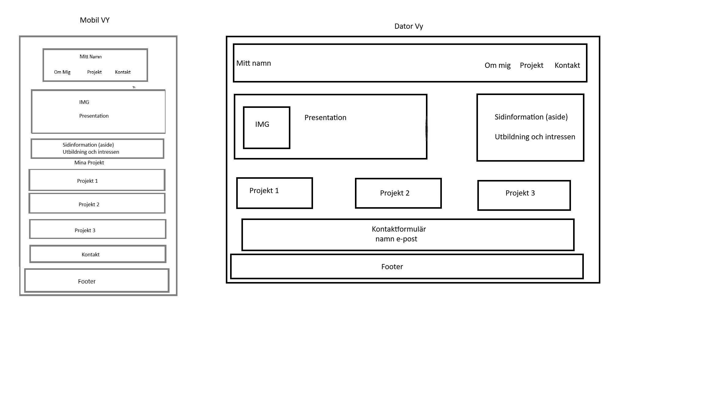
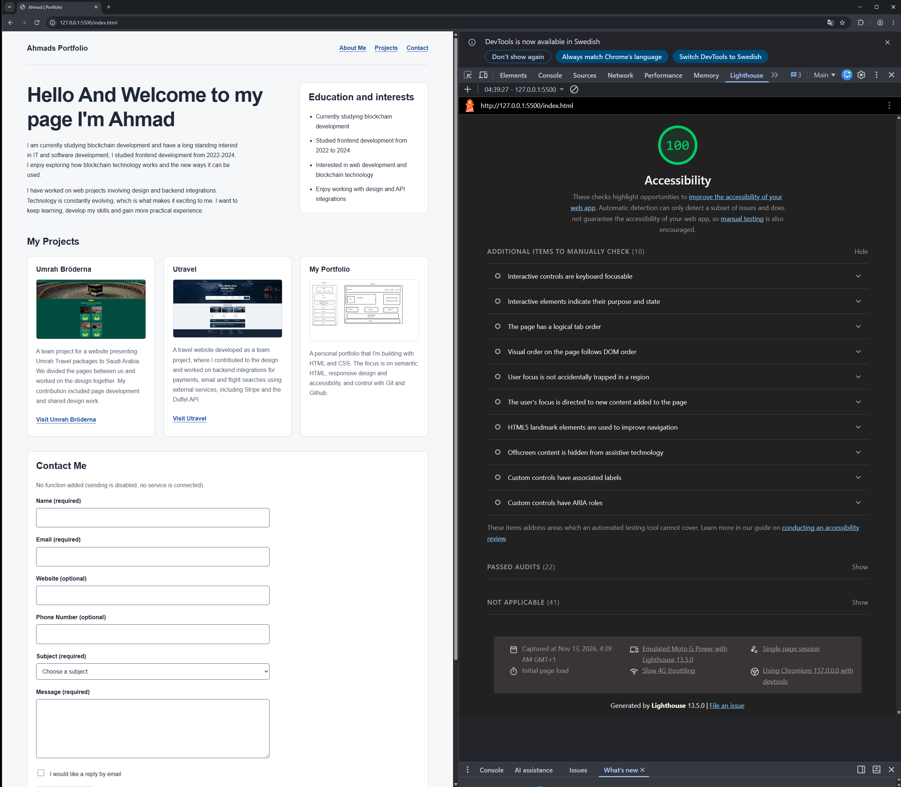
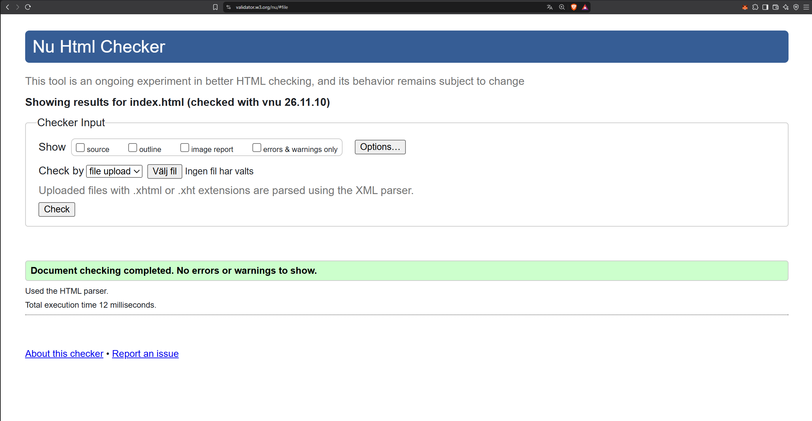
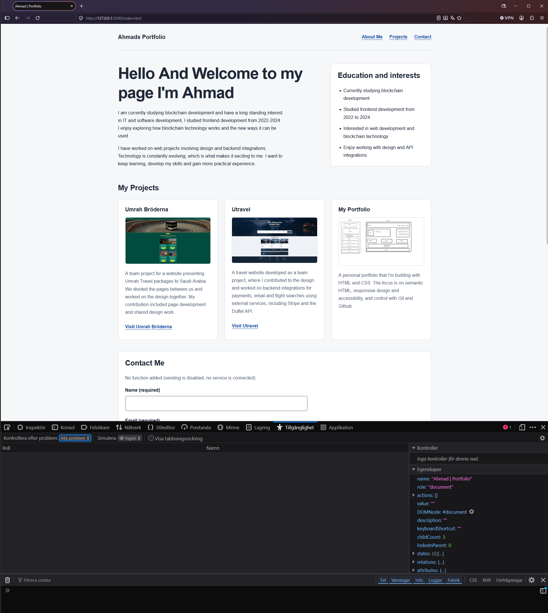

# Portfolio
Inlämningsuppgift 1 - Portfolio BCU26D HTML&CSS

Denna sida är min personliga portfolio.
Sidan innehåller en presentation, tre projekt och ett kontaktformulär.

Layouten är responsiv för mobil, surfplatta och dator.

## Design och tillgänglighet

Jag har använt mig av CSS variabler för återkommande färger.
Grid och flexbox anpassar layouten till olika skärmstorlekar.
Sidan har semantiska HTML-element, etiketter för formulärfälten och synliga fokusmarkeringar för tangentbordsnavigering.

## Kontaktformulär

Formuläret är en HTML övning utan kopplad meddelandetjänst, därför är "skicka knappen" avstängd

## Kör Projektet

För att köra projektet öppna index.html i webbläsaren eller starta sidan med Live Server i VS code.

## Tekniker:

- HTML
- CSS
- Git och Github

## Skiss:
Min planerade layout för mobil och dator

## Publicerad sida:

[Live-sida](https://zerkeyt.github.io/Portfolio/)

[Projekt koden på GitHub](https://github.com/Zerkeyt/Portfolio)

### Granskning:
Resultat och skärmbilder läggs till efter tester med:

- Chrome Lighthouse

    Kontroll av sidan med Chrome Lighthouse i mobil läge, resultat 100/100 för accessibility
    Manuella kontroller behövs också eftersom automatiska tester inte upptäcker alla tillgänglighetsproblem

    

- W3C HTML Validator

    Kontroll av index.html med Nu HTML Checker, utan anmärkning

    

- Firefox Accessibility Tools

    Kontroll av sidan med Firefox Accessibility Tools utan anmärkning, inga rapporterade problem.

    Manuell testning - Shift + Tab: 
    Det gick att flytta bakåt mellan länkar och formulärfält.

    Space: Fungerade att markera och avmarkera checkboxen.

    